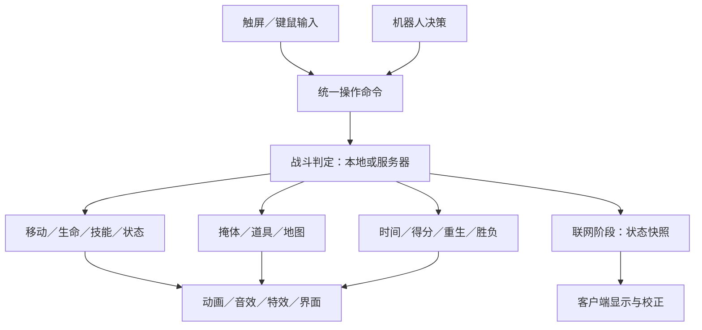

# Godot 技术架构 v0.1

本文为待实现架构，当前仓库还没有下述游戏目录或脚本。目标是支撑“2D 纵深表现 → 人机原型 → 少量玩家在线对战”，先使用 Godot 场景、节点和 Resource，不搭建通用大型游戏框架。

## 1. 技术基线

| 项目 | 建议 |
| --- | --- |
| 引擎 | 创建工程时锁定一个稳定 Godot 4.x 完整版本，编辑器与导出模板匹配 |
| 语言 | GDScript，核心数据与接口尽量使用类型标注 |
| 图形 | 纯 2D；CharacterBody2D、Area2D、AnimatedSprite2D、Camera2D、TileMapLayer |
| 渲染器 | 优先评估 Compatibility，在目标 Android 手机上确认效果与性能 |
| 物理 | 初始 60 次／秒，移动和战斗计时在物理更新中处理 |
| 平台 | 建议 Android 横屏首发，Windows 方便开发；iOS 暂不排入原型 |
| 网络 | M3 评估 ENet＋Godot 无界面专用服务端，服务器权威判定 |
| 配置 | 自定义 Resource 与 `.tres`；原型不引入远程配置后台 |
| 存档 | 本地仅保存音量、操作偏好等；在线成绩不能信任本地存档 |

Godot 官方将 Compatibility 作为 2D 和广泛硬件适配的起点之一；本项目仍需用实际设备验证选型。[渲染器说明](https://docs.godotengine.org/en/stable/tutorials/rendering/renderers.html)

## 2. 模块与数据流



| 模块 | 负责 | 边界 |
| --- | --- | --- |
| InputController | 把键鼠或触屏转成移动／攻击／技能意图 | 不直接扣血，不决定胜负 |
| BotController | 按观察结果生成相同意图 | 不绕过技能、视线或射程约束 |
| Actor | 移动、生命、状态与能力组件的组织 | 不内嵌菜单或平台 SDK |
| AbilityRunner | 检查与执行能力，维护实例冷却和施法状态 | 读取配置，不把运行状态写入共享资源 |
| CombatResolver | 统一处理命中、阵营过滤、伤害与去重 | 本地模式本地执行，联网时服务器执行 |
| WorldInteractable | 掩体、拾取和区域效果 | 与角色共用伤害／状态接口 |
| MatchController | 开始、计时、得分、重生、结束和重开 | 不依赖特定 UI；事件通知展示层 |
| Presentation／HUD | 动画、声音、命中反馈、冷却与结果 | 不作为伤害判定的唯一依据 |
| NetworkSession | 连接、身份绑定、命令传输与快照 | M3 开始；不把业务判断散落到所有 UI 脚本 |
| PlatformServices | 平台登录等能力的适配入口 | 与战斗隔离；开发桩与真实接入明确区分 |

场景内部优先使用直接引用和局部信号。初期全局单例只需场景切换与设置；后续确有跨场景需要再增加会话、音频管理，避免先建立全局事件总线或 ECS。

## 3. 建议目录

仓库根目录保留设计文档；Godot 根目录建议放在 `game/`。以下仅为规划，随功能出现再建目录，不创建没有用途的空壳。

```text
Fowl Play/
├── README.md
├── docs/
└── game/
    ├── project.godot
    ├── app/                 # 启动、场景切换、设置
    ├── actors/
    │   ├── actor.tscn       # 共享角色场景
    │   ├── components/     # 生命、状态、能力等
    │   ├── controllers/    # 键鼠、触屏、AI 意图
    │   └── visuals/        # 鸡／猪／马的外观与动画
    ├── combat/
    │   ├── abilities/      # 近战、发射、增速、冲锋、区域
    │   ├── projectiles/
    │   └── effects/
    ├── matches/             # 训练场、对局、胜负控制
    ├── maps/
    │   ├── farm_test.tscn
    │   └── interactables/
    ├── ui/                 # 菜单、HUD、摇杆、技能按钮、结算
    ├── data/               # 动物、能力、道具、对局配置 .tres
    ├── network/            # M3 才添加
    ├── platform/           # Android／TapTap 适配
    └── assets/             # 图像、音效、字体；授权见 docs
```

Godot 生成的 `.godot/`、本地导出包与签名秘密不提交；必要源文件与所选版本要求的 UID 文件正常提交。素材原稿过大时再评估 Git LFS，首个原型先使用少量小资源。

## 4. 关键场景与 2.5D 排序

```text
Battle (Node)
├── MapRoot (Node2D)
│   ├── Ground (TileMapLayer，固定底层)
│   ├── GroundEffects (Node2D，泥地／地面标记)
│   ├── Sortables (Node2D，y_sort_enabled = true)
│   │   ├── PlayerActor (CharacterBody2D，原点在脚底)
│   │   ├── BotActor (同类角色场景)
│   │   ├── Fence (StaticBody2D，原点在地面基准)
│   │   ├── HayStack (StaticBody2D)
│   │   ├── CornPickup (Area2D)
│   │   └── Projectile (Area2D，根位置为地面位置)
│   └── OverlayVFX (Node2D，少量明确需要盖住场景的效果)
├── CameraRig (Node2D + Camera2D)
├── MatchController (Node)
└── HUD (CanvasLayer)
    ├── MatchHUD
    └── MobileControls
```

需要彼此前后遮挡的物体放在同一个排序范围，使用相同的有效 `z_index`。各物体根原点设在脚底／地面接触基准，根内部的贴图向上偏移。不要把角色和干草堆分别放进未参与共同排序的容器。

在 `Sortables` 开启 Y 排序，而单个角色根保持内部子节点作为整体绘制；地面与提示层单独管理。Godot 只有在相同 Z 层内才会比较 Y 顺序。[CanvasItem 的 Y 排序与 Z 层](https://docs.godotengine.org/en/stable/classes/class_canvasitem.html#class-canvasitem-property-y-sort-enabled)

角色建议组成：

```text
Actor (CharacterBody2D，地面位置，不随瞄准整体旋转)
├── BodyCollision (CollisionShape2D，脚底小圆／胶囊)
├── Shadow (Sprite2D)
├── VisualRoot (Node2D，可做上下弹动)
│   └── AnimatedSprite2D
├── HurtArea (Area2D + CollisionShape2D，地面受击投影)
├── AimPivot (Node2D，方向独立)
│   └── Muzzle (Marker2D)
├── HealthComponent (Node)
├── StatusComponent (Node)
└── AbilityRunner (Node)
```

首版弹体沿 2D 地面直线飞行，命中依据地面受击区。若后续加入抛物线，只给显示节点额外的视觉高度；是否越过围栏必须单独写进技能规则，不能根据贴图看起来更高就改变碰撞。

## 5. 输入接口与坐标

输入命令建议包含：移动向量 `move_vector`、瞄准方向 `aim_direction`、是否普攻 `attack_pressed`、技能槽 `ability_slot`；联网时再补充序号与时间信息。移动向量长度限制在 0–1，瞄准向量不能为无效值。

触屏位置属于屏幕／视口坐标，角色位置属于世界坐标。鼠标瞄准要经过 Camera2D／Canvas 变换，不能直接用屏幕位置减世界位置。射程与移动速度使用统一的游戏单位，分辨率缩放不改变规则。

摇杆与技能区使用独立触点 ID。摇杆设死区、最大半径与松手复位；按钮每次按压只产生一次动作，不因 `_process` 每帧重复发送。简单点按可评估支持多点触摸的 TouchScreenButton；拖拽与取消使用明确的触摸捕获逻辑。[TouchScreenButton 文档](https://docs.godotengine.org/en/stable/classes/class_touchscreenbutton.html)

## 6. 动物与能力配置

| 资源 | 建议字段 |
| --- | --- |
| AnimalDefinition | 稳定 ID、显示名、生命上限、移速、碰撞尺寸、外观场景、普攻引用、技能引用 |
| AbilityDefinition | ID、目标类型、自身／方向／地面点、射程、冷却、前摇、后摇、行为脚本或效果场景 |
| ProjectileDefinition | 速度、最大距离、伤害、碰撞范围、是否穿透、表现资源 |
| PickupDefinition | 类型、效果值、刷新时间、拾取条件、图标 |
| MatchDefinition | 规则 ID、时长、分数目标、复活与保护时间、地图引用 |

Resource 保存设计配置，并可能被多个角色共享。当前生命、冷却倒计时、状态层数、攻击归属和目标 ID 放在角色实例或战斗状态中，不能直接写回共享 `.tres`。

不要用一个巨大 `animal_type` 分支处理所有行为。增速、近战、发射、区域、冲锋各是一种能力行为，动物通过组合资源使用；先实现鸡需要的两种行为，再随着新动物增加。

## 7. 统一战斗判定

执行链：意图 → 检查是否存活／受控／冷却完成／目标合法 → 前摇 → 生效 → 命中筛选 → 伤害与状态 → 后摇／冷却 → 发出展示事件。

首版建议冷却在能力成功进入生效阶段时开始；前摇被打断则取消本次释放且不进入完整冷却。死亡立即取消未生效动作；已发出的弹体继续存在并保留攻击者 ID，比赛结束时全部停止。具体技能可另设规则。

移动状态与能力阶段分别管理，避免“攻击就必定不能移动”。鸡的普攻和增速允许移动；死亡与眩晕等控制状态按优先级禁止对应动作。减速先采用取最强值而非无限相乘，按来源 ID 添加／移除。

伤害事件至少携带 `attack_id`、攻击者 ID、目标 ID、伤害值与方向。默认非穿透弹体只生效一次即销毁；近战同一攻击对同一目标去重；致死与得分只结算一次。击败归属、重生与比赛结束统一交给 MatchController。

高速弹体或冲锋从上个物理位置到下个位置做射线／形状扫掠，避免只依赖离散 Area 重叠导致穿过薄围栏。地图碰撞、目标碰撞、无敌保护和穿透策略要有明确先后顺序。

碰撞层建议按用途命名：WorldSolid、Actors、Hurtboxes、Projectiles、Pickups、Zones。移动体阻挡关系与伤害关系分开；阵营、攻击归属和免伤在逻辑层进一步过滤，不靠无限增加碰撞层区分玩家。

## 8. 人机与完整对局

BotController 只输出与玩家相同的操作意图。先实现接近目标 → 进入射程 → 攻击 → 冷却期间移动；有固定障碍后使用简易导航或路径寻路，避免只做永远朝玩家直走的机器人。

对局状态：`Loading → Countdown → Playing → Finished → Restarting/Exit`。比赛状态按单向转换控制；UI 监听状态显示，不能自己改得分。重开时重新实例化对局场景是一种简单方案，但设置、输入捕获和网络会话等跨场景对象仍需主动清理／保留。

## 9. 联网演进

M1–M2 先本地执行同一套判定入口，不逐个角色提前堆 RPC。M3 用真实双客户端验证接口，届时补齐命令编号、快照与服务器归属。早期拆分只能降低改造量，不能假定本地逻辑接上网络就自动正确。

| 内容 | 权威来源 | 客户端职责 |
| --- | --- | --- |
| 移动 | 服务器最终碰撞和位置 | 采集输入，本地可预测，接快照后校正 |
| 技能和冷却 | 服务器检查并执行 | 发送请求，播放确认／必要的预测效果 |
| 命中、生命、得分 | 服务器 | 展示结果，不上报“已经打掉多少血” |
| 掩体与道具 | 服务器 | 展示破坏、拾取和刷新 |
| AI、重生和胜负 | 服务器 | 接收状态并更新 UI |

初始评估服务器 60 tick／秒、快照 10–20 次／秒，实际频率以测得的设备、带宽与体验决定。连续移动输入与状态可使用带序号的非可靠有序传输；技能动作、生成销毁与结果使用可靠传输并去重。客户端丢弃旧快照。

正式体验通常还需要远端插值，以及本地预测与服务器纠正。Godot 物理不应被假定为跨设备确定性锁步；首版不用输入锁步。服务器验证发送者控制的角色、向量范围、命令频率、技能冷却与目标距离，不接受客户端指定自身权限。

Godot 提供 ENet、高层多人 API 和服务器导出支持，但它们不等同于完整房间服务或安全的战斗实现；公网接入还需部署可达服务端和正确的 UDP 网络配置。Android 联网包还需启用 INTERNET 权限。[高层多人说明](https://docs.godotengine.org/en/stable/tutorials/networking/high_level_multiplayer.html)

正式房间需要玩家会话、准入验证、版本匹配与异常离开处理；“房间码”只是查找房间的入口，不会自动解决 NAT 或托管服务器。TapTap 登录与平台能力也不替代战斗服务器和同步。

## 10. Android 与平台适配

在 M0 导出空 APK，M1 验证多指触摸，M2 验证完整一局。目标设备、帧率、发热与内存需要用实际构建记录；建议先以选定中端手机稳定 60 FPS 为目标，低端设备是否支持 30 FPS 档在测试后决定。

平台层留窄接口，例如登录／票据／防沉迷状态入口，具体范围取决于所选服务。Godot 工程如果不能直接使用选定 SDK，先验证 Android 插件桥接、回调与导出链路。开发模式的模拟登录绝不能视为真实平台接入已完成。[Godot Android 插件](https://docs.godotengine.org/en/stable/tutorials/platform/android/android_plugin.html)、[Android 导出](https://docs.godotengine.org/en/stable/tutorials/export/exporting_for_android.html)

## 11. 验证方式

- 每增加一种基础能力，用训练场直接观察射程、命中、冷却与边界。
- M2 用完整对局检查状态清理；核心计分、重复命中、状态叠加等稳定后可补少量逻辑测试。
- M3 之后检查独立服务端与两个独立客户端；多人问题不能只在单实例调试模式中判断。
- 触控、相机视野、流畅度和包体行为必须真机检查。详细检查项见 [任务书](first-prototype.md) 和 [路线图](roadmap.md)。
